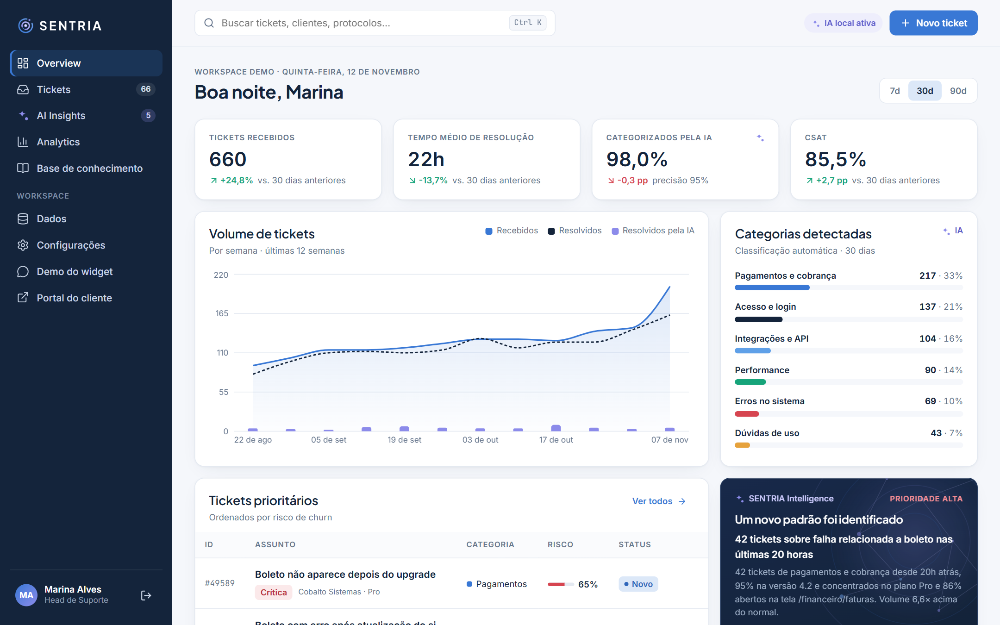
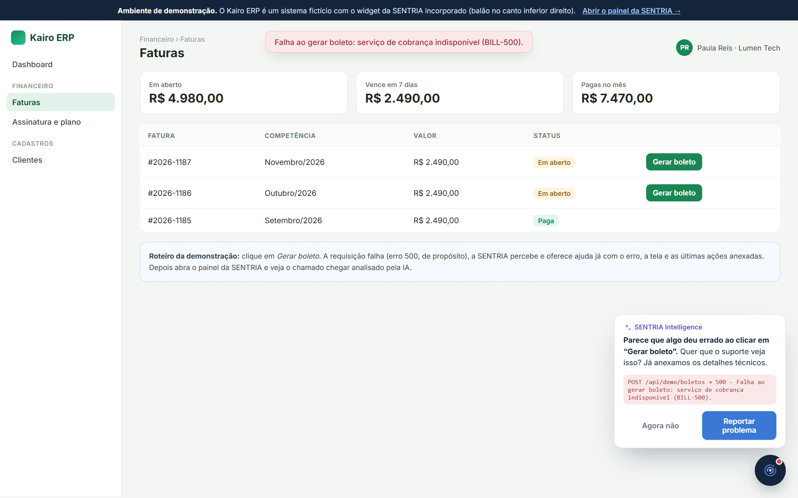
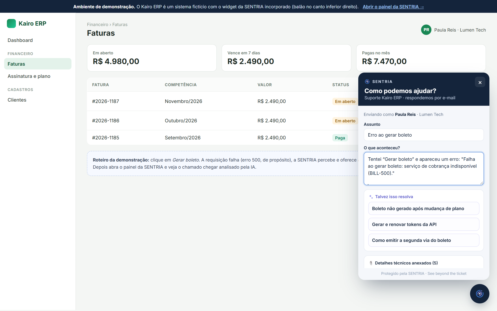
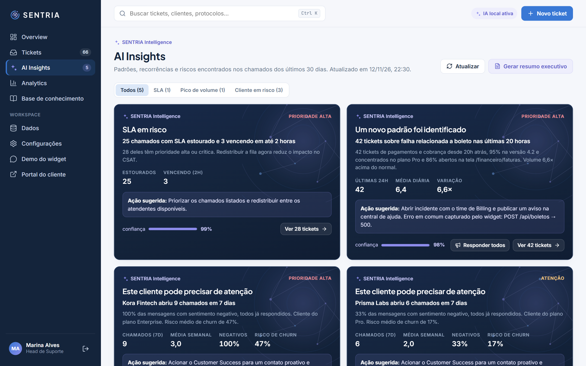
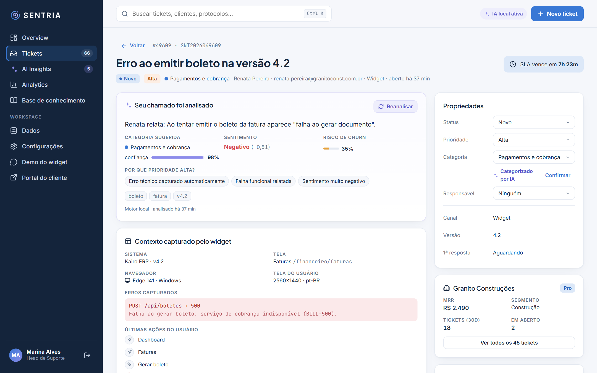
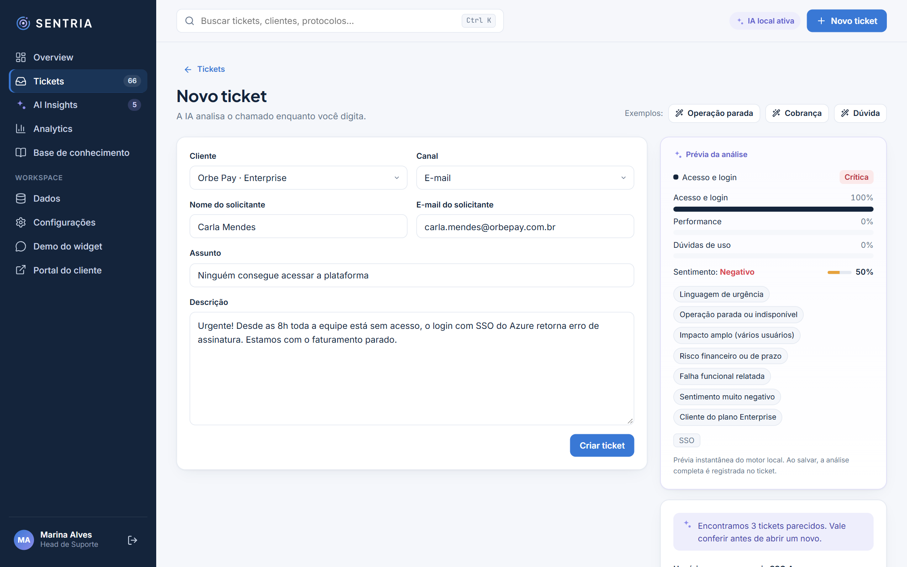
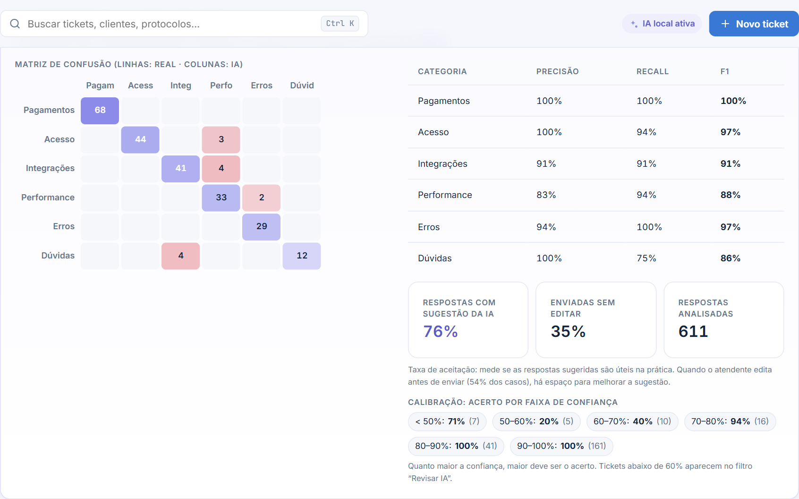
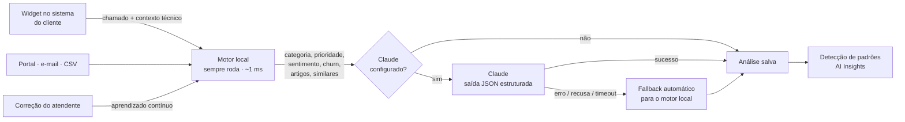

<p align="center">
  
</p>

<p align="center">
  <strong>AI-powered Customer Intelligence Platform</strong><br/>
  <em>See beyond the ticket. Enxergue além do chamado.</em>
</p>

<p align="center">
  <a href="https://github.com/ThaysaCosta/sentria/actions/workflows/ci.yml"></a>
  
  
  
  
</p>

<p align="center">
  <a href="https://render.com/deploy?repo=https://github.com/ThaysaCosta/sentria"></a>
</p>

---

A **SENTRIA** se acopla ao sistema de uma empresa como um balão de suporte. Quando algo dá errado, ela percebe o erro, oferece ajuda e abre o chamado já com todo o contexto técnico. Depois, a IA **categoriza, prioriza com explicação, sugere a resposta, mede o risco de churn e encontra padrões antes que virem crise**.

<p align="center">
  
</p>

> **Exemplo real da demonstração:** sem nenhuma regra escrita para isso, a SENTRIA percebe que *42 tickets sobre falha relacionada a boleto nas últimas 20 horas*, 95% na versão 4.2, concentrados no plano Pro e 86% abertos na tela `/financeiro/faturas`, estão 6,6× acima do normal. Ela aponta o erro em comum capturado pelo widget (`POST /api/boletos → 500`), sugere abrir um incidente com o time de Billing e permite **responder todos os afetados com um comunicado**.

> 🎨 **Identidade visual e direção de marca:** a SENTRIA tem um [brand book próprio](docs/brand/sentria-brand-book.html) (conceito, símbolo, paleta, tipografia, tom de voz e aplicações), que serviu de especificação para a interface. Para vê-lo formatado, baixe o arquivo e abra no navegador.

## Sumário

- [O widget: suporte dentro do sistema do cliente](#o-widget-suporte-dentro-do-sistema-do-cliente)
- [Funcionalidades](#funcionalidades)
- [Telas](#telas)
- [Como rodar](#como-rodar)
- [Como a IA funciona](#como-a-ia-funciona)
- [Arquitetura](#arquitetura)
- [API](#api)
- [Testes e qualidade](#testes-e-qualidade)
- [Decisões técnicas](#decisões-técnicas)
- [Próximos passos](#próximos-passos)
- [Desenvolvimento com IA](#desenvolvimento-com-ia)

## O widget: suporte dentro do sistema do cliente

Num produto B2B, o cliente não quer sair da tela em que está trabalhando para procurar um portal de chamados. A SENTRIA entra **no próprio sistema** com uma linha de código:

```html
<script src="https://SEU-DOMINIO/widget.js" data-app="Kairo ERP" data-version="4.2" defer></script>
<script>
  // opcional: o sistema informa quem é o usuário logado
  Sentria.identify({ name: 'Paula Reis', email: 'paula@empresa.com.br', company: 'Lumen Tech', plan: 'Pro' });
</script>
```

| Erro detectado → ajuda proativa | Chamado com contexto anexado |
|---|---|
|  |  |

- **Detecta erros sozinho:** falhas de requisição (HTTP 5xx), erros de JavaScript e promises rejeitadas. Quando um erro acontece, o balão oferece ajuda ("Parece que algo deu errado ao clicar em *Gerar boleto*") e já preenche o chamado.
- **Contexto técnico automático:** tela, versão do sistema, navegador, usuário, erros e as últimas ações (navegação e cliques). O atendente não precisa perguntar "em qual tela?".
- **Transparente:** o usuário vê exatamente o que será anexado antes de enviar. Nada de senhas ou do conteúdo digitado em formulários.
- **Autoatendimento:** enquanto o usuário descreve o problema, a IA sugere artigos. Se um resolve, o atendimento é registrado como *resolvido pela IA*.
- **Isolado e leve:** um único arquivo JavaScript, sem dependências, com Shadow DOM (não interfere no visual do sistema hospedeiro).

**Experimente:** com o projeto rodando, abra **`/demo.html`**. É o *Kairo ERP*, um sistema fictício com o widget instalado. Clique em **Gerar boleto**: a requisição falha de propósito, o widget oferece ajuda e o chamado chega na SENTRIA já analisado.

## Funcionalidades

| Área | O que faz |
|---|---|
| **Widget incorporável** | Balão de suporte para qualquer sistema web, com detecção de erros, contexto técnico e sugestões da IA (veja acima). |
| **Análise de cada chamado** | Categoria (com confiança e ranking), prioridade **explicável** ("por que prioridade alta?"), sentimento, risco de churn, resumo em uma frase, tags e **resposta sugerida** pronta para revisão. Erros capturados pelo widget viram sinal de prioridade. |
| **Prévia em tempo real** | Ao criar um ticket, a análise aparece enquanto o atendente digita, junto com tickets parecidos já existentes (evita duplicidade). |
| **Fila de atendimento** | Busca, filtros combináveis (status, prioridade, categoria, canal, responsável, SLA estourado, *Revisar IA*), ordenação, paginação, ações em lote e exportação do recorte filtrado. |
| **Detalhe do ticket** | Conversa, notas internas, "usar resposta sugerida", SLA com contagem regressiva, **contexto técnico do widget** (tela, erros, trilha de ações), dados do cliente, tickets parecidos, artigos sugeridos e linha do tempo auditável. |
| **Aprendizado contínuo** | Quando um atendente corrige ou confirma a categoria, o classificador aprende na hora (peso 2) e a correção entra no retreinamento. |
| **AI Insights** | Detecção automática de **picos por categoria** (com tela e erro em comum), **clientes fora do próprio padrão**, **grupos de tickets parecidos**, **SLA em risco** e **mudança de sentimento**, cada um com confiança, métricas e ação sugerida. |
| **Resposta em massa** | A partir de um incidente detectado, um comunicado sugerido pela IA é enviado a todos os tickets afetados, personalizado com o nome de cada cliente. |
| **Resumo executivo** | Texto pronto para a liderança, gerado a partir dos indicadores e padrões da semana (Claude quando configurado, modelo local caso contrário). |
| **Analytics** | Volume diário, sentimento, mapa de calor dia × hora, SLA, canais, equipe, clientes em risco e **qualidade da IA**: matriz de confusão, precisão, recall, F1, calibração e **taxa de aceitação** das respostas sugeridas. |
| **Portal do cliente** | Canal secundário para abrir e acompanhar chamados por protocolo + e-mail, com conversa e avaliação (CSAT). |
| **Dados** | Importação de CSV com detecção automática de colunas, validação linha a linha e prévia da IA. Exportação em CSV (Excel) e JSON. Reprocessamento em massa. |
| **Base de conhecimento** | CRUD de artigos com busca semântica (TF-IDF), que alimenta as sugestões do widget, do portal e do atendimento. |

## Telas

| AI Insights | Detalhe do ticket |
|---|---|
|  |  |
| **Prévia da IA ao criar um ticket** | **Qualidade da classificação da IA** |
|  |  |

## Como rodar

**Pré-requisito:** [Node.js](https://nodejs.org) 22.13 ou superior. Não precisa instalar banco de dados: o SQLite já vem embutido no Node.

```bash
npm install
npm run dev
```

| Endereço | O que é |
|---|---|
| **http://localhost:5173** | Painel da SENTRIA (equipe de suporte) |
| **http://localhost:5173/demo.html** | Kairo ERP: sistema de exemplo com o widget |
| **http://localhost:5173/portal** | Portal do cliente |

Contas de demonstração:

| E-mail | Senha | Perfil |
|---|---|---|
| `marina@sentria.demo` | `sentria123` | Head de Suporte (admin) |
| `rafael@sentria.demo` | `sentria123` | Analista (agente) |

Na primeira execução o banco é criado com **90 dias de histórico fictício** (cerca de 1.600 chamados, 36 empresas, 16 artigos), incluindo chamados vindos do widget com contexto técnico.

| Comando | O que faz |
|---|---|
| `npm start` | Gera o build e sobe tudo em **http://localhost:3333** (modo produção, um único processo). |
| `docker compose up` | Sobe a SENTRIA em contêiner, com os dados num volume persistente. |
| `npm run seed` | Recria os dados de demonstração (também disponível em *Dados › Restaurar*). |
| `npm test` | Roda os testes automatizados. |
| `npm run typecheck` | Checagem de tipos do backend e do frontend. |

> Os dados de demonstração são relativos à data em que foram gerados. Se ninguém criou chamados reais e o seed tem mais de 36 horas, o servidor o renova sozinho ao iniciar, para que os padrões "das últimas horas" continuem atuais.

### Publicar online (Render)

O repositório inclui um [`render.yaml`](render.yaml). Clique no botão **Deploy to Render** no topo desta página (ou, no Render, *New › Blueprint* e selecione o repositório). No plano gratuito, o disco é temporário: os dados de demonstração são recriados quando o serviço reinicia, o que é ideal para uma demo pública.

### Ativando o Claude (opcional)

Tudo funciona **sem chave e offline** com o motor local. Para usar o Claude na análise de novos chamados e no resumo executivo:

```bash
cp .env.example .env
```

Preencha `ANTHROPIC_API_KEY` no `.env` (ou nas variáveis de ambiente do Render) e reinicie. O modelo padrão é `claude-opus-5-5` (configurável em `CLAUDE_MODEL`). O indicador no topo da tela mostra qual motor está ativo.

## Como a IA funciona

A SENTRIA usa **duas camadas de IA**, pensadas para funcionar sempre e com custo previsível:



**Motor local** (`server/src/ai/`), implementado do zero, sem bibliotecas de ML:

- **Classificador Naive Bayes multinomial** com unigramas e bigramas, normalização de acentos e stemming leve para português. Usa também a tela de origem capturada pelo widget como evidência. As probabilidades são calibradas por temperatura, e o treino usa um corpus próprio, diferente dos dados de demonstração, para que a precisão medida seja honesta (~95%).
- **Sentimento** por léxico em português, com tratamento de negação ("não foi bom"), intensificadores e sinais tipográficos (CAIXA ALTA, "!!!").
- **Prioridade explicável**: regras ponderadas (operação parada, impacto amplo, risco financeiro, possível incidente de dados, erro técnico capturado, plano do cliente, sentimento). Cada ponto vira um *sinal* legível exibido na interface.
- **Risco de churn**: menções a cancelamento ou concorrentes, ameaça de escalonamento, recorrência, sentimento e histórico de 7 dias do cliente.
- **Similaridade TF-IDF + cosseno** para tickets parecidos e busca semântica na base de conhecimento.
- **Resumo extrativo** (frase mais informativa) e **resposta sugerida** por categoria, personalizada pelo nome, pelo sentimento e pelo artigo mais relevante.

**Claude** (`server/src/ai/claudeEngine.ts`), via SDK oficial `@anthropic-ai/sdk`:

- Uma única chamada com **saída estruturada (JSON Schema)**, validada com Zod antes de ser aceita.
- O prompt recebe as categorias, as definições de prioridade, o tom de voz do brand book, o **contexto técnico do widget** e os artigos candidatos encontrados pelo motor local (ancoragem para não inventar conteúdo).
- *Fallback* no servidor da Anthropic em caso de recusa, e fallback local em qualquer erro (chave inválida, limite de uso, rede, formato inesperado). O motivo fica registrado na linha do tempo do ticket.

**Detecção de padrões** (`server/src/ai/insights.ts`), funções puras e testadas:

| Padrão | Regra |
|---|---|
| Pico de volume | Últimas 24h da categoria ≥ 2,2× a média diária dos 14 dias anteriores (mín. 8 tickets). Descreve versão, plano, tela e erro predominantes e **une picos do mesmo tema** em categorias diferentes. |
| Cliente em risco | ≥ 5 tickets em 7 dias **e** ≥ 2,5× a média semanal do próprio cliente. Tickets que já fazem parte de um incidente não contam (o incidente os explica). |
| Tickets parecidos | Agrupamento guloso de tickets abertos com similaridade de cosseno ≥ 0,42. |
| SLA em risco | Tickets abertos com SLA estourado ou vencendo em até 2 horas. |
| Sentimento | Variação ≥ 6 p.p. na proporção de negativos, semana contra semana. |

## Arquitetura

```
SENTRIA/
├── server/                 API · Node + Express 5 + TypeScript
│   ├── src/
│   │   ├── ai/             classificador, motor local, Claude, insights, PLN
│   │   ├── db/             schema SQLite (node:sqlite), seed e dados fictícios
│   │   ├── routes/         tickets, portal/widget públicos, analytics, KB, dados
│   │   ├── services/       regras de negócio (tickets, analytics)
│   │   ├── context.ts      validação do contexto técnico enviado pelo widget
│   │   └── utils/          CSV sem dependências
│   └── test/               Vitest (IA, insights, CSV)
├── web/                    Frontend · React 19 + Vite + TypeScript
│   ├── public/
│   │   ├── widget.js       widget incorporável (JS puro + Shadow DOM)
│   │   └── demo.html       Kairo ERP, sistema de exemplo com o widget
│   └── src/                páginas, design system do brand book, cliente da API
├── docs/                   brand book e capturas de tela
├── samples/                CSV de exemplo para testar a importação
├── Dockerfile · docker-compose.yml · render.yaml
└── .github/workflows/      CI: tipos, testes, build e smoke test (Node 22 e 24)
```

**Stack:** Node.js · Express 5 · TypeScript (strict) · SQLite nativo do Node (`node:sqlite`) · Zod · JWT · React 19 · React Router 7 · Recharts · Lucide · Vite · Vitest · SDK oficial da Anthropic · Docker · GitHub Actions.

**Segurança:** senhas com `scrypt` e comparação em tempo constante, JWT com expiração, validação de toda entrada com Zod (o contexto do widget é truncado e limitado), consultas SQL parametrizadas, *rate limit* nas rotas públicas, CORS aberto apenas para as rotas públicas do widget e, no portal, acesso a um chamado apenas com protocolo **e** o e-mail de quem abriu.

## API

Todas as rotas abaixo de `/api`, exceto `auth/login` e `public/*`, exigem `Authorization: Bearer <token>`.

| Método | Rota | Descrição |
|---|---|---|
| POST | `/auth/login` | Login (retorna JWT) |
| GET | `/tickets` | Lista com filtros (`search`, `status`, `priority`, `category`, `channel`, `assignee`, `ids`, `slaBreached`, `lowConfidence`, `days`), ordenação e paginação |
| GET | `/tickets/export?format=csv\|json` | Exporta o recorte filtrado |
| GET | `/tickets/:id` | Ticket + contexto técnico + conversa + linha do tempo + cliente + similares + artigos |
| POST | `/tickets` | Cria e analisa com IA |
| PATCH | `/tickets/:id` | Status, prioridade (recalcula SLA), categoria (ensina a IA), responsável |
| POST | `/tickets/:id/messages` | Resposta ao cliente ou nota interna (registra se usou a sugestão da IA) |
| POST | `/tickets/:id/reanalyze` | Reanalisa (Claude, se configurado) |
| POST | `/tickets/bulk` · `/tickets/bulk-reply` | Ações em lote · comunicado para vários tickets |
| POST | `/ai/preview` | Prévia instantânea da análise |
| GET | `/ai/status` | Motor ativo, exemplos de treino, última falha do Claude |
| GET | `/analytics/overview?days=7\|30\|90` | KPIs com variação, volume semanal, categorias, prioritários |
| GET | `/analytics/detail?days=…` | Séries, mapa de calor, SLA, equipe, matriz de confusão, taxa de aceitação |
| GET | `/insights` · POST `/insights/summary` | Padrões detectados · resumo executivo |
| CRUD | `/kb` | Base de conhecimento (com busca semântica) |
| POST | `/data/import/preview` · `/data/import` | Importação de CSV |
| POST | `/data/reprocess` · `/data/reset` | Reprocessamento com IA · restaurar demo (admin) |
| POST | `/public/suggest` · `/public/tickets` | Widget e portal: sugestões e abertura de chamado (aceita `context`) |
| GET/POST | `/public/tickets/:protocolo` (+ `/messages`, `/csat`) | Acompanhamento, resposta e avaliação |

## Testes e qualidade

```bash
npm test          # 29 testes: classificador, sentimento, prioridade, churn, insights e CSV
npm run typecheck # TypeScript strict no backend e no frontend
```

A cada envio ao GitHub, o **GitHub Actions** roda checagem de tipos, testes, build e um *smoke test* da API em Node 22 e 24.

Além dos testes, a página **Analytics › Qualidade da classificação da IA** mede a IA em uso: compara a categoria prevista com a revisada pela equipe (matriz de confusão, precisão, recall, F1, calibração) e mostra a **taxa de aceitação** das respostas sugeridas (quantas foram usadas e quantas foram enviadas sem edição). Tickets com confiança abaixo de 60% aparecem no filtro **Revisar IA**.

## Decisões técnicas

- **Suporte onde o problema acontece.** O widget leva o atendimento para dentro do sistema do cliente e transforma erros técnicos em contexto, o que reduz a troca de mensagens e dá à IA sinais muito mais precisos do que o texto do chamado.
- **IA que funciona sem chave.** Um avaliador consegue rodar tudo com `npm install && npm run dev`, sem cadastro nem custo. O Claude entra como camada opcional de maior qualidade e nunca é ponto único de falha.
- **Explicabilidade antes de "caixa-preta".** Toda prioridade vem com os motivos, toda categoria com a confiança, e as métricas de acerto ficam visíveis. Atendentes confiam mais em uma IA que mostra por que decidiu.
- **Humano no circuito.** A IA sugere e a pessoa decide: as respostas são revisadas antes do envio, cada correção vira treino e a taxa de aceitação mostra se as sugestões ajudam de verdade.
- **Privacidade por padrão.** O widget mostra ao usuário o que será anexado e não coleta senhas nem o conteúdo digitado em formulários.
- **SQLite nativo do Node.** Zero dependências nativas para compilar e zero serviços externos. Trocar por PostgreSQL exige mudar apenas a camada `db/`.
- **Seed determinístico.** Os dados fictícios são reproduzíveis (PRNG com semente fixa) e incluem cenários planejados (pico após a versão 4.2, cliente recorrente) para demonstrar os insights.
- **Identidade visual como especificação.** Cores, tipografia, raios, sombras, grafismo "Campo de Percepção" e o marcador de IA seguem o brand book. A lavanda é usada **apenas** para conteúdo de IA.

## Próximos passos

- Captura de tela (screenshot) opcional no widget e gravação dos últimos segundos da sessão.
- Canais reais de entrada (e-mail via IMAP/webhook, WhatsApp Business API).
- Notificações em tempo real (WebSocket) e alertas de insights no Slack/Teams.
- Embeddings semânticos para similaridade e busca (mantendo o TF-IDF como fallback).
- Multi-tenant (workspaces), chave por empresa no widget e PostgreSQL.

## Desenvolvimento com IA

A ideia, o posicionamento e a identidade visual ([brand book](docs/brand/sentria-brand-book.html) e logos) foram definidos por mim. A implementação foi desenvolvida em par com o **Claude Code**: arquitetura, backend, motor de IA, widget, frontend, testes e documentação foram construídos de forma iterativa, com validação no navegador e testes automatizados a cada etapa.

---

<p align="center"><sub>SENTRIA · Every interaction tells a story. · Todos os nomes de empresas e pessoas nos dados de demonstração são fictícios.</sub></p>
