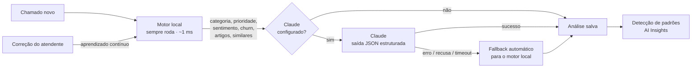

<p align="center">
  
</p>

<p align="center">
  <strong>AI-powered Customer Intelligence Platform</strong><br/>
  <em>See beyond the ticket. Enxergue além do chamado.</em>
</p>

<p align="center">
  
  
  
  
  
</p>

---

A **SENTRIA** recebe chamados de suporte, entende cada um com IA e transforma o volume de atendimento em indicadores que orientam decisões. Ela vai além da gestão de tickets: **categoriza, prioriza, sugere respostas, mede o risco de churn e encontra padrões antes que virem crise**.

> **Exemplo real da demonstração:** sem nenhuma regra escrita para isso, a SENTRIA percebe que *"49 tickets sobre falha relacionada a boleto nas últimas 24 horas"*, 100% na versão 4.2 e concentrados no plano Pro, estão cerca de 6× acima do normal. Ela une os chamados que a IA tinha separado entre "Pagamentos" e "Erros no sistema" e sugere abrir um incidente com o time de Billing.

> 🎨 **Identidade visual e direção de marca:** a SENTRIA tem um [brand book próprio](docs/brand/sentria-brand-book.html) (conceito, símbolo, paleta, tipografia, tom de voz e aplicações), que serviu de especificação para a interface. Para vê-lo formatado, baixe o arquivo e abra no navegador.

## Sumário

- [Funcionalidades](#funcionalidades)
- [Como rodar](#como-rodar)
- [Como a IA funciona](#como-a-ia-funciona)
- [Arquitetura](#arquitetura)
- [API](#api)
- [Testes e qualidade](#testes-e-qualidade)
- [Decisões técnicas](#decisões-técnicas)
- [Próximos passos](#próximos-passos)
- [Desenvolvimento com IA](#desenvolvimento-com-ia)

## Funcionalidades

| Área | O que faz |
|---|---|
| **Portal do cliente** | O cliente abre um chamado sem login. Enquanto digita, a IA sugere artigos da base de conhecimento. Se um artigo resolve, o atendimento é registrado como *resolvido pela IA*. O cliente acompanha o chamado por protocolo + e-mail, conversa com o time e avalia o atendimento (CSAT). |
| **Análise de cada chamado** | Categoria (com confiança e ranking), prioridade **explicável** ("por que prioridade crítica?"), sentimento, risco de churn, resumo em uma frase, tags e **resposta sugerida** pronta para revisão. |
| **Prévia em tempo real** | Ao criar um ticket, a análise aparece enquanto o atendente digita, junto com tickets parecidos já existentes (evita duplicidade). |
| **Fila de atendimento** | Busca, filtros combináveis (status, prioridade, categoria, canal, responsável, SLA estourado, *Revisar IA*), ordenação, paginação, ações em lote e exportação do recorte filtrado. |
| **Detalhe do ticket** | Conversa com o cliente, notas internas, "usar resposta sugerida", SLA com contagem regressiva, contexto do cliente (plano, MRR, histórico), tickets parecidos, artigos sugeridos e linha do tempo auditável. |
| **Aprendizado contínuo** | Quando um atendente corrige ou confirma a categoria, o classificador aprende na hora (peso 2) e a correção entra no retreinamento. |
| **AI Insights** | Detecção automática de **picos por categoria**, **clientes fora do próprio padrão**, **grupos de tickets parecidos**, **SLA em risco** e **mudança de sentimento**, cada um com confiança, métricas e ação sugerida. |
| **Resumo executivo** | Texto pronto para a liderança, gerado a partir dos indicadores e padrões da semana (Claude quando configurado, modelo local caso contrário). |
| **Analytics** | Volume diário por categoria, sentimento ao longo do tempo, mapa de calor dia × hora, SLA por prioridade, canais, desempenho da equipe, clientes em risco e **qualidade da IA** (matriz de confusão, precisão, recall, F1 e calibração por faixa de confiança). |
| **Dados** | Importação de CSV com detecção automática de colunas, validação linha a linha e prévia da IA antes de importar. Exportação em CSV (Excel) e JSON. Reprocessamento em massa com o modelo retreinado. |
| **Base de conhecimento** | CRUD de artigos com busca semântica (TF-IDF). Os artigos alimentam as sugestões da IA no portal e no atendimento. |

## Como rodar

**Pré-requisito:** [Node.js](https://nodejs.org) 22.13 ou superior (testado no Node 26). Não precisa instalar banco de dados: o SQLite já vem embutido no Node.

```bash
npm install
npm run dev
```

Abra **http://localhost:5173** e entre com a conta de demonstração:

| E-mail | Senha | Perfil |
|---|---|---|
| `marina@sentria.demo` | `sentria123` | Head de Suporte (admin) |
| `rafael@sentria.demo` | `sentria123` | Analista (agente) |

Na primeira execução o banco é criado com **90 dias de histórico fictício** (cerca de 1.600 chamados, 36 empresas, 16 artigos). O portal do cliente fica em **http://localhost:5173/portal**.

Outros comandos:

| Comando | O que faz |
|---|---|
| `npm start` | Gera o build do frontend e sobe tudo em **http://localhost:3333** (modo produção, um único processo). |
| `npm run seed` | Recria os dados de demonstração (também disponível em *Dados › Restaurar*). |
| `npm test` | Roda os testes automatizados. |
| `npm run typecheck` | Checagem de tipos do backend e do frontend. |

> Os dados de demonstração são relativos à data em que foram gerados. Se ninguém criou chamados reais e o seed tem mais de 36 horas, o servidor o renova sozinho ao iniciar, para que os padrões "das últimas horas" continuem atuais.

### Ativando o Claude (opcional)

Tudo funciona **sem chave e offline** com o motor local. Para usar o Claude na análise de novos chamados e no resumo executivo:

```bash
cp .env.example .env
```

Preencha `ANTHROPIC_API_KEY` no `.env` e reinicie. O modelo padrão é `claude-opus-5-5` (configurável em `CLAUDE_MODEL`). O indicador no topo da tela mostra qual motor está ativo.

## Como a IA funciona

A SENTRIA usa **duas camadas de IA**, pensadas para funcionar sempre e com custo previsível:



**Motor local** (`server/src/ai/`), implementado do zero, sem bibliotecas de ML:

- **Classificador Naive Bayes multinomial** com unigramas e bigramas, normalização de acentos e stemming leve para português. As probabilidades são calibradas por temperatura para evitar a confiança de 100% típica do Naive Bayes. Ele é treinado com um corpus próprio, propositalmente diferente dos dados de demonstração, para que a precisão medida seja honesta (~94%).
- **Sentimento** por léxico em português, com tratamento de negação ("não foi bom"), intensificadores e sinais tipográficos (CAIXA ALTA, "!!!").
- **Prioridade explicável**: regras ponderadas (operação parada, impacto amplo, risco financeiro, possível incidente de dados, plano do cliente, sentimento). Cada ponto vira um *sinal* legível exibido na interface.
- **Risco de churn**: menções a cancelamento ou concorrentes, ameaça de escalonamento, recorrência, sentimento e histórico de 7 dias do cliente.
- **Similaridade TF-IDF + cosseno** para tickets parecidos e busca semântica na base de conhecimento.
- **Resumo extrativo** (frase mais informativa) e **resposta sugerida** por categoria, personalizada pelo nome, pelo sentimento e pelo artigo mais relevante.

**Claude** (`server/src/ai/claudeEngine.ts`), via SDK oficial `@anthropic-ai/sdk`:

- Uma única chamada com **saída estruturada (JSON Schema)**, validada com Zod antes de ser aceita.
- O prompt recebe a descrição das categorias, as definições de prioridade, o tom de voz do brand book e os artigos candidatos encontrados pelo motor local (ancoragem para não inventar conteúdo).
- *Fallback* no servidor da Anthropic em caso de recusa, e fallback local em qualquer erro (chave inválida, limite de uso, rede, formato inesperado). O motivo fica registrado na linha do tempo do ticket.
- O risco de churn continua determinístico, porque depende do histórico do cliente no banco.

**Detecção de padrões** (`server/src/ai/insights.ts`), funções puras e testadas:

| Padrão | Regra |
|---|---|
| Pico de volume | Últimas 24h da categoria ≥ 2,2× a média diária dos 14 dias anteriores (mín. 8 tickets). Descreve versão, plano e tema predominantes e **une picos do mesmo tema** em categorias diferentes. |
| Cliente em risco | ≥ 5 tickets em 7 dias **e** ≥ 2,5× a média semanal do próprio cliente nas 3 semanas anteriores. |
| Tickets parecidos | Agrupamento guloso de tickets abertos com similaridade de cosseno ≥ 0,42. |
| SLA em risco | Tickets abertos com SLA estourado ou vencendo em até 2 horas. |
| Sentimento | Variação ≥ 6 p.p. na proporção de negativos, semana contra semana. |

## Arquitetura

```
SENTRIA/
├── server/                 API · Node + Express 5 + TypeScript
│   ├── src/
│   │   ├── ai/             classificador, motor local, Claude, insights, PLN
│   │   ├── db/             schema SQLite (node:sqlite), seed e dados fictícios
│   │   ├── routes/         tickets, portal público, analytics, KB, dados
│   │   ├── services/       regras de negócio (tickets, analytics)
│   │   └── utils/          CSV sem dependências
│   └── test/               Vitest (IA, insights, CSV)
├── web/                    Frontend · React 19 + Vite + TypeScript
│   └── src/
│       ├── pages/          Overview, Tickets, Detalhe, Insights, Analytics, KB, Dados, Portal…
│       ├── components/     design system do brand book (tokens, badges, cards de IA)
│       └── lib/            cliente da API, autenticação, formatação pt-BR
├── samples/                CSV de exemplo para testar a importação
└── docs/brand/             brand book da SENTRIA
```

**Stack:** Node.js · Express 5 · TypeScript (strict) · SQLite nativo do Node (`node:sqlite`) · Zod · JWT · React 19 · React Router 7 · Recharts · Lucide · Vite · Vitest · SDK oficial da Anthropic.

**Segurança:** senhas com `scrypt` e comparação em tempo constante, JWT com expiração, validação de toda entrada com Zod, consultas SQL parametrizadas, *rate limit* nas rotas públicas e, no portal, acesso a um chamado apenas com protocolo **e** o e-mail de quem abriu.

## API

Todas as rotas abaixo de `/api`, exceto `auth/login` e `public/*`, exigem `Authorization: Bearer <token>`.

| Método | Rota | Descrição |
|---|---|---|
| POST | `/auth/login` | Login (retorna JWT) |
| GET | `/tickets` | Lista com filtros (`search`, `status`, `priority`, `category`, `channel`, `assignee`, `ids`, `slaBreached`, `lowConfidence`, `days`), ordenação e paginação |
| GET | `/tickets/export?format=csv\|json` | Exporta o recorte filtrado |
| GET | `/tickets/:id` | Ticket + conversa + linha do tempo + cliente + similares + artigos |
| POST | `/tickets` | Cria e analisa com IA |
| PATCH | `/tickets/:id` | Status, prioridade (recalcula SLA), categoria (ensina a IA), responsável |
| POST | `/tickets/:id/messages` | Resposta ao cliente ou nota interna |
| POST | `/tickets/:id/reanalyze` | Reanalisa (Claude, se configurado) |
| POST | `/tickets/bulk` | Ações em lote |
| POST | `/ai/preview` | Prévia instantânea da análise |
| GET | `/ai/status` | Motor ativo, exemplos de treino, última falha do Claude |
| GET | `/analytics/overview?days=7\|30\|90` | KPIs com variação, volume semanal, categorias, prioritários |
| GET | `/analytics/detail?days=…` | Séries, mapa de calor, SLA, equipe, matriz de confusão |
| GET | `/insights` · POST `/insights/summary` | Padrões detectados · resumo executivo |
| CRUD | `/kb` | Base de conhecimento (com busca semântica) |
| POST | `/data/import/preview` · `/data/import` | Importação de CSV |
| POST | `/data/reprocess` · `/data/reset` | Reprocessamento com IA · restaurar demo (admin) |
| POST | `/public/suggest` · `/public/tickets` | Portal: sugestões e abertura de chamado |
| GET/POST | `/public/tickets/:protocolo` (+ `/messages`, `/csat`) | Portal: acompanhamento, resposta e avaliação |

## Testes e qualidade

```bash
npm test          # 28 testes: classificador, sentimento, prioridade, churn, insights e CSV
npm run typecheck # TypeScript strict no backend e no frontend
```

Além dos testes unitários, a página **Analytics › Qualidade da classificação da IA** mede a IA em produção: compara a categoria prevista com a revisada pela equipe e mostra matriz de confusão, precisão, recall, F1 e se a confiança está bem calibrada. Tickets com confiança abaixo de 60% aparecem no filtro **Revisar IA**.

## Decisões técnicas

- **IA que funciona sem chave.** Um avaliador consegue rodar tudo com `npm install && npm run dev`, sem cadastro nem custo. O Claude entra como camada opcional de maior qualidade e nunca é ponto único de falha.
- **Explicabilidade antes de "caixa-preta".** Toda prioridade vem com os motivos, toda categoria com a confiança, e as métricas de acerto ficam visíveis. Atendentes confiam mais em uma IA que mostra por que decidiu.
- **Humano no circuito.** A IA sugere e a pessoa decide: as respostas são revisadas antes do envio, e cada correção vira treino.
- **SQLite nativo do Node.** Zero dependências nativas para compilar e zero serviços externos. Trocar por PostgreSQL exige mudar apenas a camada `db/`.
- **Seed determinístico.** Os dados fictícios são reproduzíveis (PRNG com semente fixa) e incluem cenários planejados (pico após a versão 4.2, cliente recorrente) para demonstrar os insights.
- **Identidade visual como especificação.** Cores, tipografia, raios, sombras, grafismo "Campo de Percepção" e o marcador de IA seguem o brand book. A lavanda é usada **apenas** para conteúdo de IA, para que a pessoa distinga um botão comum de uma análise inteligente sem precisar ler.

## Próximos passos

- Canais reais de entrada (e-mail via IMAP/webhook, WhatsApp Business API).
- Notificações em tempo real (WebSocket) e alertas de insights no Slack/Teams.
- Embeddings semânticos para similaridade e busca (mantendo o TF-IDF como fallback).
- Multi-tenant (workspaces) e papéis com permissões granulares.
- PostgreSQL + Docker Compose para implantação.

## Desenvolvimento com IA

A ideia, o posicionamento e a identidade visual ([brand book](docs/brand/sentria-brand-book.html) e logos) foram definidos por mim. A implementação foi desenvolvida em par com o **Claude Code**: arquitetura, backend, motor de IA, frontend, testes e documentação foram construídos de forma iterativa, com validação no navegador e testes automatizados a cada etapa.

---

<p align="center"><sub>SENTRIA · Every interaction tells a story. · Todos os nomes de empresas e pessoas nos dados de demonstração são fictícios.</sub></p>
